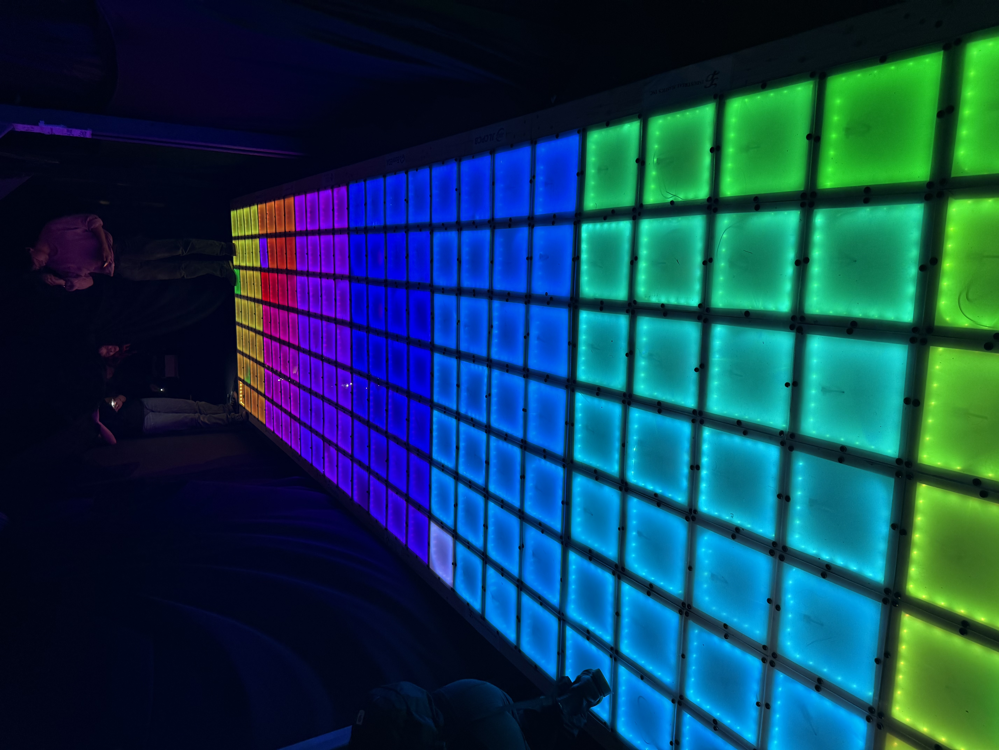

Every year, MIT hosts Residence EXploration (REX), a multi-day, campus-wide event where incoming freshmen partake in dorm activities to decide which dorm they want to live in. My dorm EAsT camPUS spends thousands of man-hours building [massive wooden structures](https://youtu.be/RXyzGZMpu_I?si=BEltpzfNYp0hge4V){:target="_blank" rel="noopener noreferrer"}. For REX 2026, I, along with my friends Vivian Ang and [Xinlan Tanner](https://xinlan.myportfolio.com/){:target="_blank" rel="noopener noreferrer"}, led the design and construction of *The Grid*, a massive interactive LED dance floor.

This project was spearheaded by the 3 of us, all of us being MIT '29s and living on the [same hall](https://tetazoo.mit.edu/){:target="_blank" rel="noopener noreferrer"} (Tetazoo!). Over the course of 10 months (4 working months) as freshman, we funded, designed, tested, led mass production, and deployed our build.

I was responsible for designing the system-level power and communications architecture, all PCB design and testing, all electronics component sourcing, designing the software SDK and firmware architecture, as well as firmware testing.

{: .align-center style="width: 600px; height: 500px; object-fit: cover; object-position: 100% 20%"}

<!-- 

  
  
  

 -->

  
  
  

## Ideation
The idea for the LED dance floor stemmed from those interactive game rooms you see on the internet, and we thought it would be cool to make our own. A brief internet research spree found a video and documentation from [AvWuff](https://www.avbrand.com/projects/dancefloor/){:target="_blank" rel="noopener noreferrer"}, who built a giant interactive LED dance floor for Furnal Equinox 2017. This planted the seed for the rough architecture of our floor, including its modular design and the use of microswitches.

## Technical Specs
- Size: 5.8’ x 23.3’
- Resolution: 7 x 28 pixels
- 196 total pixels, broken down into 49 modules of 4 pixels each
- 196 microswitches, one under each pixel
- Pixel dimension: 10” x 10”
- 49 custom-designed PCBs
- 4900 total LEDs
- Total power draw: 800W (33A at 24V)
- Capable of 30FPS
- RS-485 communication bus running across all modules

  
  

## Overview
We wanted a modular structure for our dance floor, as this would be the easiest to prototype and iterate on. Each module contains 4 pixels, and has a PCB with a microcontroller that is responsible for the lighting and step detection of those 4 pixels. The modules share a common RS-485 communications bus and all communicate to a controller board, which sends out color frame data, and takes in step (microswitch) data from each module.

Because of our floor resolution, we chose 1x4 pixel modules, which also reduced the bus length. 

Each module is mounted inside a wooden frame and a 1/8 inch polycarbonate square is drilled into each pixel. We found that polycarbonate supported dancers' weights while also flexing enough to trigger the microswitches underneath.

<figure style="max-width: 500px; margin: 2em auto;">
  
</figure>

## Electronics Overview
The Grid is composed of 49 modules, each housing a custom-designed PCB. Each PCB/module is responsible for 4 individual pixels, meaning that it controls 4 LED strips and reads data from 4 microswitches. A single RS-485 communication bus runs throughout the entire floor, allowing color frame data to be broadcast to all modules and modules to respond back with microswitch data.

The PCB I designed consists of a microcontroller, an RS-485 transceiver, MOSFETs for LED control, 24V step-down components, and switch input components.

I designed the architecture and drew up a diagram of how power and communication ran through the floor:

<figure style="max-width: 800px; margin: 2em auto;">
  
</figure>

### PCB Overview
The final iteration of the PCB designed in KiCAD includes:
- STM32 Blue Pill (soldered onto PCB) as microcontroller
- Buck Converter to step down 24V to 5V to feed into the Blue Pill
- RS-485 Transceiver
- MOSFETs for LED control
- Screw Terminals for all power, communication, LED, and microswitch connections
    
The STM32 Blue Pill outputted 12 PWM signals that connected to MOSFETs to drive 4 LEDs. It also took in 4 microswitch input readings. For each PCB in a module, power (24V and GND) and comms (RSA and RSB) come in one end and out the other. 

We expected an absolute maximum of 9A through each PCB, so I designed each to handle around 16A of maximum current.



<figure style="max-width: 500px; margin: 2em auto;">
  
</figure>

### LEDs
Going into the project, we had a few requirements for our LEDs:
- 24V, so we have a lower current draw across our wires and power supplies
- Cheap, because we are broke
- In strips, so they are built for longevity and with current-limiting resistors
- Low LED strip density, also to reduce price
- RGB, because duh

While AvWuff and co’s LED floor used individually addressable LED strips, I took a few looks at IC strips and realized that their price was far out of our range. In addition, they usually do not come in 24V strips. Thus, I decided on using “dumb” (non-IC) LED strips.

After some digging around on Aliexpress and Alibaba, I found [Ray Wu's LEDs](https://www.aliexpress.us/item/3256804861632375.html?spm=a2g0o.order_list.order_list_main.5.21ef1802LBmgap&gatewayAdapt=glo2usa) on Aliexpress. They seemed to be one of the only reputable sellers who offered 24V, 30LED/m, RGB, dumb LED strips at a reasonable price point, which was exactly what we wanted. RAY WU OUR GOAT!!!

<figure style="max-width: 600px; margin: 2em auto;">
  
  <figcaption>At first we didn’t actually think the 30 LED/m 24V strips were real, cause they were the only one on Aliexpress we could find. But then they turned out to be real. One hundred blessings to Ray Wu.</figcaption>
</figure>

As our LEDs are non-addressable, we cannot simply have a signal wire to control the color of each strip. Instead, we must have 24V at the V+ pin, and based on how much R, G, B we want in each strip, we PWM low-side MOSFET per pin to pull them to GND. 

For example, if we wanted 70% Red and 30% Blue, we PWM 70% duty cycle on the R pin MOSFET and PWM 30% duty cycle on the B pin MOSFET. R and B would then be pulled down to GND by their respective amounts.

So, as long as we had 12 PWM pins on our microcontroller and 12 appropriately-wired MOSFETs, each module PCB could control all 4 LEDs.

### Microswitches
During our initial brainstorming, we wanted to have force-sensitive resistors (FSRs) or strain gauges to detect footsteps on pixels. This would allow us to have true pressure sensitivity and also tune the pressure threshold for footsteps. However, like all parts of this project, we were limited by cost.

<figure style="max-width: 300px; margin: 2em auto;">
  
  <figcaption>oh god one dollar for an fsr this is the worst thing ever 100 tomatoes to fsrs</figcaption>
</figure>

Thus, we followed in the footsteps of AvWuff and team and used microswitches. After all, we only really need a binary input for each pixel.

<figure style="max-width: 300px; margin: 2em auto;">
  
  <figcaption>yippee ten cents for a microswitch this is the best thing ever 100 gold stars to microswitches</figcaption>
</figure>

### Communication
As all modules are in close proximity with each other, we wanted to use a wired connection (cost and complexity of wireless eek!!). I chose to use differential signaling for communication due to its robustness. 

At first, I considered CAN, but was advised to choose RS-485 for its simplicity. In addition, RS-485 can have up to 256 devices on a single bus with fractional unit loading.

I used a one-controller many-device architecture for the RS-485 bus. Each module on the floor has a unique MODULE_ID.
- A single controller board connects to a computer over USB-CDC, which sends frame data (all LED’s colors) to the controller module
- The controller board forwards this data and broadcasts it to every single module on the bus
- Each module displays its corresponding colors in the data based on its MODULE_ID
- If a module has had one of its microswitches pressed within frame N, it replies back with its microswitch data at a designated time slot after receiving frame N, also based on its MODULE_ID
- The controller board then takes all this microswitch data and forwards it back to the computer

This way, we’re able to continuously broadcast frames as well as collect microswitch data from each module.   

For the differential pair, we purchased expensive CAN wire (same impedance) that traveled across the floor in a zig-zag pattern. The PCBs had space for a THT termination resistor, placed on the controller and last module on the bus.

### Iteration

#### PCB Rev 0
The very first concepts I had for the PCB ranged from a handful of breakout boards connected by traces, to using ESP32s and CAN, JST and XT30 connectors, to an MCU directly on the PCB. However, after consulting [with](https://www.youtube.com/@floresacton){:target="_blank" rel="noopener noreferrer"} [some](https://www.anhadsawhney.com/){:target="_blank" rel="noopener noreferrer"} [upperclassmen](https://intentionally-aimless.com/){:target="_blank" rel="noopener noreferrer"}, I slowly modified the board to use screw terminals, RS-485, and an STM32. Anhad suggested that it would reduce cost, components, and risk of errors if we made our board a shield for the STM32 Bluepill, rather than integrating all the MCU and power regulation components directly onto the PCB. This ended up being hugely beneficial in our testing.

#### PCB Rev 1
PCB Rev 1 took around 2 weeks to design. After I was finished with this iteration, we sent out 10 boards to JLCPCB as a prototyping run. This gave us opportunity to test and identify any errors before we do the full production run of 50 boards.
We were able to validate all the systems on the first iteration!

#### PCB Rev 2
PCB Rev 2 was our final production run, of which we ordered 50 boards from JLCPCB. The primary changes that I made were:
- Different RS-485 Transceiver (½ UL -> ⅛ UL)
- Filtering caps on microswitch inputs
- Board size and mounting hole change
- Impedance matching on the differential pair
- Silkscreen changes :)

## Firmware Overview
I took many of the lessons from working on the firmware for Tetris into this project. However, one of the biggest differences was that in *The Grid*, the controller board requires messages back from each module, making timing crucial. 

I created the firmware architecture for our system based on a strict timing protocol for each frame. All modules would operate under the same firmware, differentiated only by module ID. Because all PCBs shared a RS-485 bus, it was important to not squash transmissions.

### Protocol Overview
- 49 modules, 1 controller
- Modules are 1-indexed, having IDs 1-49
- Running at 30FPS, giving us ~33ms/frame
- Modules and controller send out data using UART/USART, which gets turned into RS-485
- Every frame:
	- Controller broadcasts frame data to all modules (589 bytes of RGB data, 5890 bits of transmitted data including start/stop bits)  
	- Each module takes turns transmitting microswitch data (2 bytes, 20 bits) back to controller
		- byte 0 has Module ID, byte 1 has switch data

I created this frame timing protocol:

<figure style="max-width: 1000px; margin: 2em auto;">
  
  
</figure>

### Notes:
- The frozen data reception is so modules don’t accidentally receive other modules’ switch data
- The original plan was for each module to transmit their microswitch data every frame, regardless of whether they have been stepped on. On the last day of assembly, I realized that this just created unnecessary bus transmissions, and set modules to transmit only when stepped on

## Prototyping
Squashing all the bugs in this took wayyy too long. I pulled an all-nighter in our 4-409 makerspace testing and debugging firmware.
<figure style="max-width: 1000px; margin: 2em auto;">
  
  <figcaption>i lost it a little</figcaption>
</figure>
The hours spent was all worth it though. We had a great time while testing PCB Rev 1.



## Mass Assembly
While design and prototyping took several months on-and-off, the mass assembly and integration of all the modules took place over 36 hours. Of those 36 hours, I was up for all 36 of them. I had never been more dizzy in my life.

We were able to gather many volunteers (goons) to help us with tasks such as soldering (microswitches, LEDs, and STM Blue Pills), wooden module assembly, polycarbonate cutting and drilling, and wiring. This took place in EC makerspace as well as our build site.

The three of us (Vivian, Xinlan, and I) oversaw mass assembly and helped out with various tasks. I created a quick guide on soldering wires to the LEDs, of which we had to solder 200 of. Other steps we oversaw were assembling the wooden structures, screwing LEDs into the PCBs, mounting electronics inside the frames, connecting RS-485 and power wires between each board, and finally sealing them all up with drilled polycarbonate.

On the very last day, we made the frightening realization that we did not have enough polycarbonate to complete the full floor due to having forgotten to account for the scrap losses during cutting. At 10AM the day of, Xinlan and I took an Uber to and from Home Depot to pick up another 2 sheets of PC.

While I was flashing all the PCBs 2 hours before we needed to get it running, one Blue Pill's faulty soldering had shorted 3.3V and GND, which shorted through the ST-Link and into my laptop :( I thought I had killed all of my USB ports, but thankfully, it was the e-fuse that tripped, and it was working again a while later. Vivian took over the job of flashing all the modules after that fiasco, while my computer was freaking out.

Special shoutout to Kendall for helping us mount the power supplies and Liong for helping us test!

  



  

  
  

<figure style="max-width: 600px; margin: 2em auto;">
  <figcaption>More testing clips!</figcaption>
</figure>

## Software
I put together a [quick SDK](https://github.com/JamesRXiao/The-Grid-Software){:target="_blank" rel="noopener noreferrer"} for developers to create games and animations on the LED floor. It allowed them to test their programs locally and also run them on the floor by connecting to the controller board over USB-CDC. This was largely vibe-coded so I am not going to talk too much about it, but its main purpose was to provide a bridge between our controller protocol and developers.

## Deploy Photos

  

## Misc
While I was primarily responsible for electronics, software, and coordination, I also did CAD some 3D-printed mounts in SOLIDWORKS that went on every module.

Shelf (Hold PCB, attach to side wall of each module):

Microswitch mount (drilled into wooden floor):

## Special Thanks

Special thanks to:
- CAMIT and MIT Edgerton Design2Making for sponsoring us with maker grants
- JLCPCB/EasyEDA for student PCB sponsorship and support
- Industrial Plastics Woburn for providing affordable polycarbonate sheets
- Anhad Sawhney, Nevin Thinagar, and Miguel Flores-Acton for PCB design review
- Kendall Binkley, Jonny Dorminy, Liong Ma, Madison Sutkaitis, Sora Egozy, An Phan, Patrick Cao, Audrey Johnson, Shuoyan “Andrew” Chen, James [last name unknown], and various MIT ‘30s for volunteering with fabrication and mass assembly
- Annabella Du, Ben Scaife, and Eric Hsu for software development of dance floor games and animations
- Dodecahedron build leads Erez Fass, Amelia Bronhard-Yates, and Nina Cranor for being generally helpful and helping us source things :)
- Big Build leads Graciela Leon, Lucy Gray, Paola Romero, and Nevin Thinagar for being generally helpful and helping us source things :)
- AND OF COURSE, MY PROJECT CO-LEADS VIVIAN AND XINLAN!!!!